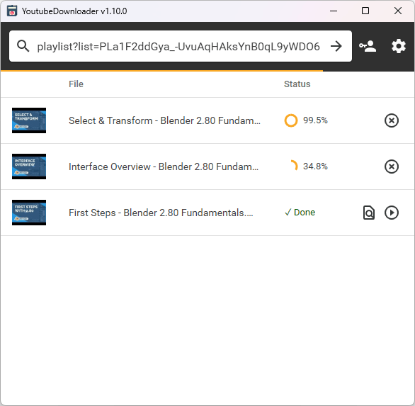
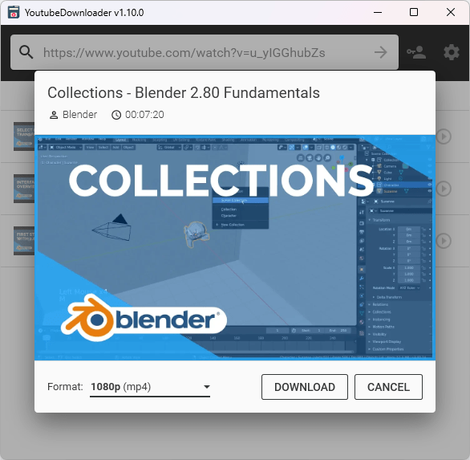
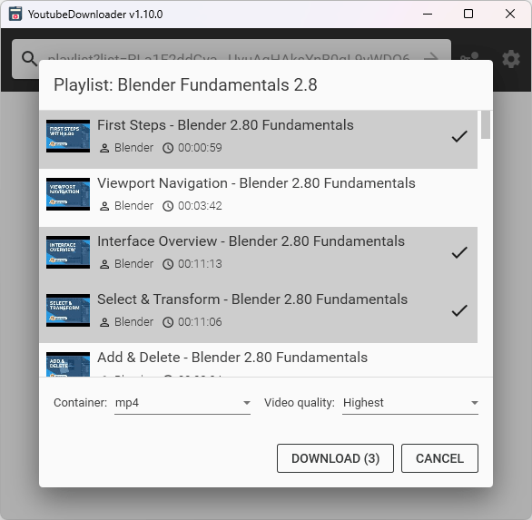

# YoutubeDownloader

<table>
    <tr>
        <td width="99999" align="center">Development of this project is entirely funded by the community. <b><a href="https://tyrrrz.me/donate">Consider donating to support!</a></b></td>
    </tr>
</table>

    

> **Made in 🇺🇦 Ukraine — [despite Russia's best efforts](https://tyrrrz.me/ukraine)**.
> Using this project or its source code comes with the implicit agreement that you condemn Russia's war of aggression against Ukraine, recognize Russia as a terrorist state, and support Ukraine's territorial integrity.

**YoutubeDownloader** is an application that lets you download videos from YouTube.
You can copy-paste the URL of any video, playlist, or channel and download it directly in a format of your choice.

**See also**:

- 📦 [YoutubeExplode](https://github.com/Tyrrrz/YoutubeExplode) — the library that powers this application
- 📖 [Reverse-Engineering YouTube](https://tyrrrz.me/blog/reverse-engineering-youtube-revisited) — article explaining the inner workings of YouTube

## Download

- 🟢 **[Stable release](https://github.com/Tyrrrz/YoutubeDownloader/releases/latest)**
- 🟠 [CI build](https://github.com/Tyrrrz/YoutubeDownloader/actions/workflows/main.yml)
- 📦 [Scoop](https://scoop.sh/#/apps?q=YoutubeDownloader&p=1&id=2c0182d9ff5edefc525a57d50ead470d8f02184f): `scoop install extras/youtubedownloader` (community-maintained)
- 📦 [AUR](https://aur.archlinux.org/packages/youtubedownloader): `yay -S youtubedownloader` (community-maintained)

> [!IMPORTANT]
> To launch the app on MacOS, you may need to first remove the downloaded file from quarantine.
> The macOS archive includes instructions in `HOW_TO_RUN_ON_MACOS.txt`, or you can run the following command in the terminal: `xattr -rd com.apple.quarantine YoutubeDownloader.app`.

> [!NOTE]
> Community-maintained packages are published independently from this repository and may not always be up to date with the latest release.

> [!NOTE]
> If you're unsure which build is right for your system, consult with [this page](https://useragent.cc) to determine your OS and CPU architecture.

## Features

- Cross-platform graphical user interface
- Download videos by URL
- Download videos from playlists or channels
- Download videos by search query
- Selectable video quality and format
- Automatically embed audio tracks in alternative languages
- Automatically embed subtitles
- Automatically inject media tags
- Log in with a YouTube account to access private content

## Screenshots

